# Ubuntu Fox Pet 🦊

## v16.1 — Fox actually faces the viewer (visual orientation hotfix)

**Fixed the real user-reported problem, not just the camera angle.** The refitted realistic fox needed a **180° model mount**, but the runtime kept mounting it at 90°. That mismatch made it look permanently sideways/backward even when the numeric body yaw was correct. The **Face Me** loop also dereferenced a null `attentionPoint`, stopping the animation frame after clicking the button.

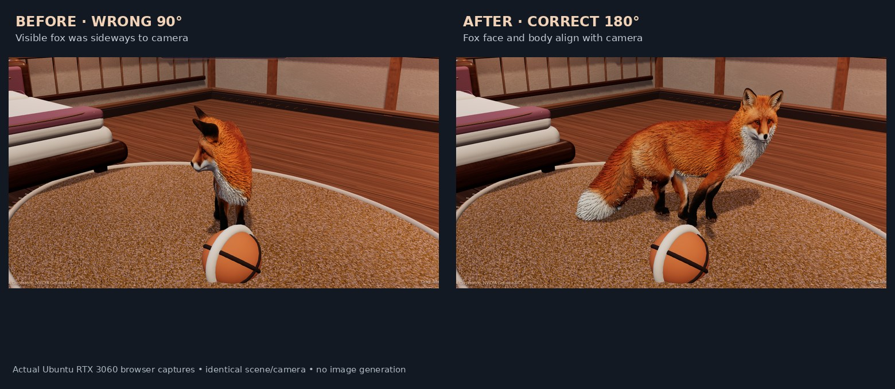

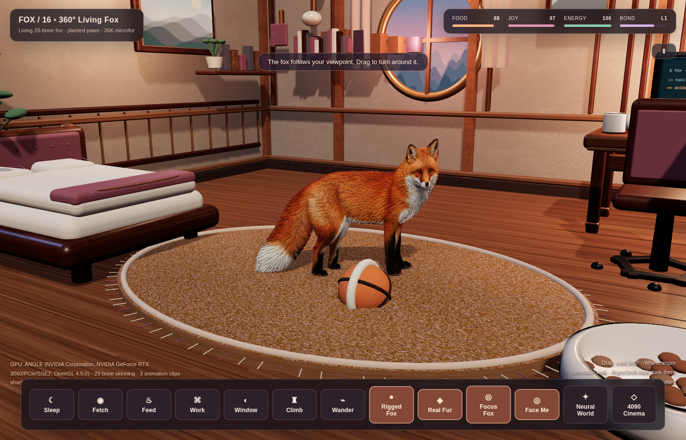

[**Watch the corrected fox maintain eye contact as the camera moves**](real3d/docs/v16-face-me-model-correction.mp4)

The app now **starts with Face Me active**, so the fox faces the viewer as soon as it loads. Camera rotation keeps it facing the viewer; clicking **Wander** or selecting a destination resumes autonomous movement. The enhanced/classic fallback rigs retain their original 90° mounting angle. A fresh Chrome session verified 0 JavaScript exceptions, correct body yaw and correct model mount in three camera positions, plus a separate navigation/IK walking test.

## v16 — Fox can look and turn in every direction

**Fixed the single-direction look/control bug.** The camera's former 142-degree horizontal clamp is gone; you can orbit a complete 360 degrees around the fox. Click **Face Me** (or press **L**) to have the fox turn toward the camera as you move it. **Right-click** or **Shift+left-click** the room to make the fox turn and look anywhere, while hovering the mouse produces subtle head tracking. Click the floor normally to resume walking.

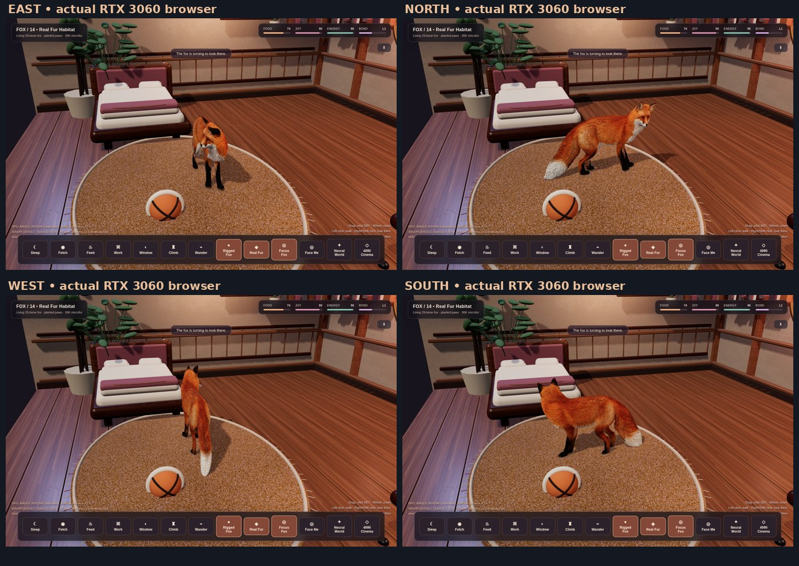

[**Watch 10.6 seconds of four-direction turning in the actual Ubuntu desktop pet**](real3d/docs/v16-fox-full-direction-demo.mp4) · [Tests and implementation](real3d/README.md)

The same 271,221-vertex fox and refitted 29-bone rig from PR #14 are retained. Real Chrome/RTX 3060 validation recorded 60 FPS, four correct world-space head/body orientations, active camera following, working right-click input, and no uncaught JavaScript exceptions. The existing v15 physics development branch remains separate.

## v14 — Living Fox: reducing the statue-like look

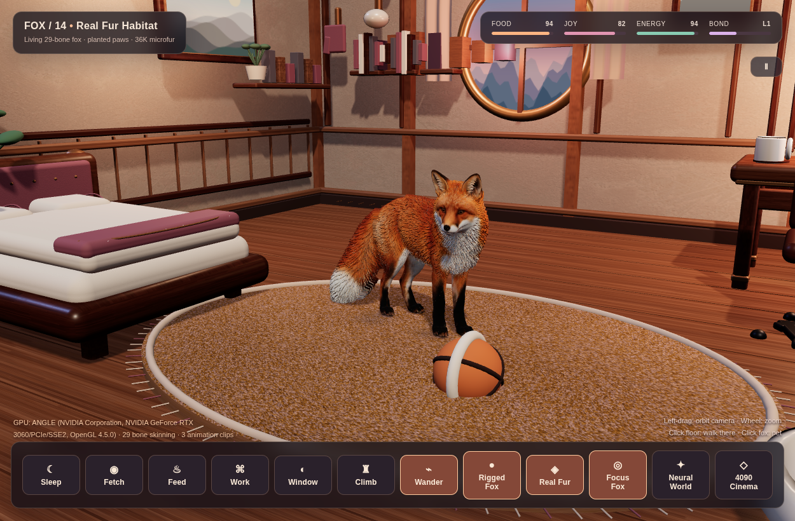

[Watch the animated animal (real app capture)](real3d/docs/v14-living-fox-motion.mp4) · [Walking view](real3d/docs/v14-living-fox-walk.png) · [Source and tests](real3d/README.md)

The existing 29-bone fox now has breathing, responsive gaze, periodic sniffing, ear flicks, torso balance, and tail follow-through, plus 36,000 vertex-anchored skinned microfur strands. Body height and paw swing were corrected against the rug; the local RTX 3060 Chrome test showed about 60 FPS and no browser JavaScript exceptions. This changes motion and surface silhouette without pretending that the base fox mesh has been replaced by a movie-quality groom.

## v13 — Ground-Aware Walking + Real Furniture Navigation

The realistic fox now has **separate planted and swinging paws, a two-joint constrained leg solver, terrain-aware body height, paw contact shadows, and obstacle-aware navigation**. It no longer walks directly through the bed, workstation, chair, food bowl or climbing tower. After reaching an activity it turns toward the relevant object, moves its head/ears/tail, and responds to petting.

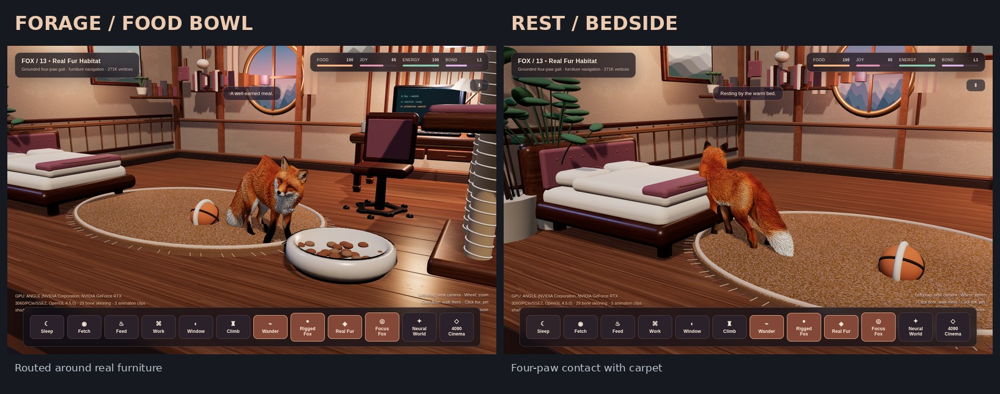

**[Watch 12.7 seconds of actual interactive 3D fox behavior](real3d/docs/v13-grounded-fox-interactions.mp4)** · [Navigation and gait implementation](real3d/README.md)

Real Ubuntu/Chrome WebGL 2 test on the RTX 3060: approximately **60 FPS at 1300×820**, with a 271,221-vertex rigged fox. The foot-target constraints limit excessive limb stretching; this is a lightweight animation/contact solver, **not** a full rigid-body animal physics simulation. The existing RTX 4090 OptiX fox still and v12 models are preserved.

## v12 — Real Fox: upgraded playable desktop pet

**The original desktop pet has finally been upgraded**: a realistic, 271,221-vertex fox skin-retargeted to the existing 29-joint animated rig. New code provides natural four-leg stepping, body motion, ear twitch and tail movement. The original 3D room and its interactions remain playable.

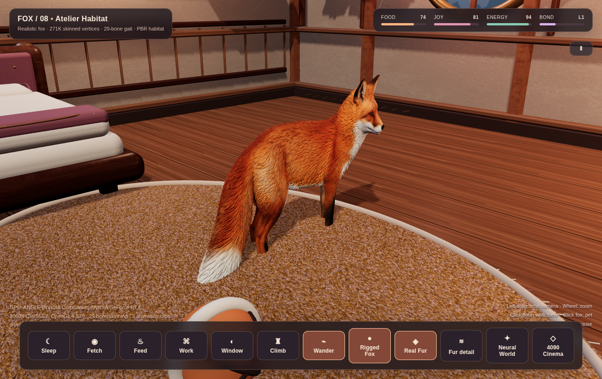

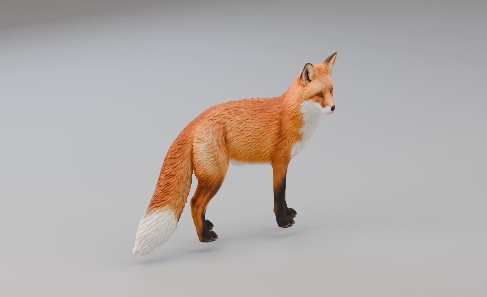

[Watch the real 3D walking video](real3d/docs/v12-real-fox-animation.mp4) · [Implementation](real3d/README.md) · [Third-party credits](real3d/assets/CREDITS.md)

Use the Focus Fox button (F key) to track the realistic animal up close, or return to the wide room view. The real-time application still works on RTX 3060. The RTX 4090 generated the high-resolution OptiX preview of the very same retargeted model — not an unrelated animal.

## v11 — RTX 4090 Neural Cinema: 4D Gaussian Splatting + OptiX

This is a **measured real RTX 4090 render** on Ubuntu, not an AI-generated concept. Dynamic 4D human motion, a volumetric 4D cat reflected inside ray-traced mirrors, and a 1600×800 film-grade cave-lion fur close-up.

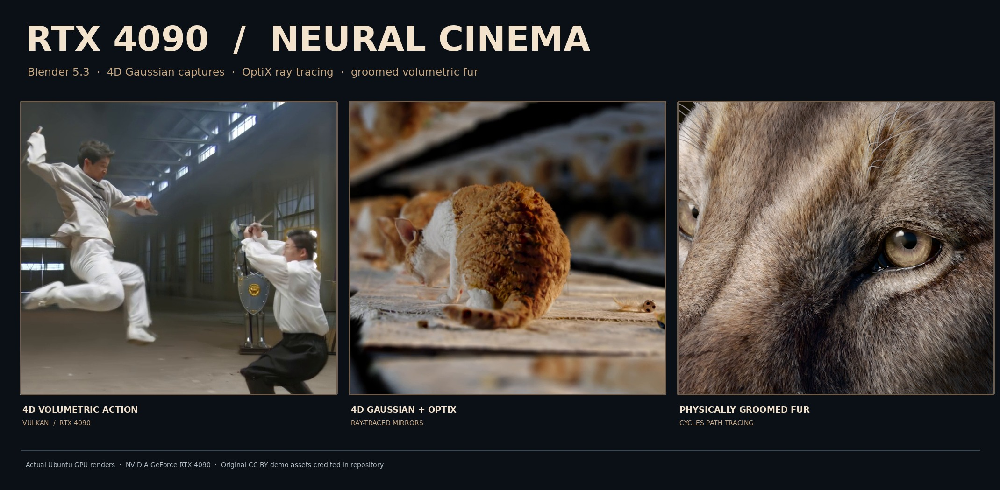

[**Watch 4D motion (5 seconds)**](real3d/rtx4090/media/4090-human-4dgs.mp4) · [**Watch OptiX 4D cat (3.33 seconds)**](real3d/rtx4090/media/4090-cat-cycles-4d.mp4) · [**Inspect original 4090 fur image**](real3d/rtx4090/media/4090-panthera-optix.png) · [**Reproduce and check GPU provenance**](real3d/rtx4090/README.md)

**RTX 4090 actually measured**: up to 100% GPU, 3,446 MiB VRAM and 342 W while rendering OptiX 4D imagery. Videos play at 24 FPS but are **offline renders**, not a claim of real-time 4D rendering. The demos are credited CC BY 4.0 upstream assets; original large Blender scene files are not uploaded.


## v10 — Neural Habitat (RTX 3060 / Gaussian Splatting)

### Live RTX 3060 captures

**Photographic neural room — 13,297,740 Gaussian splats, original unaltered scan view (fox toggled off)**

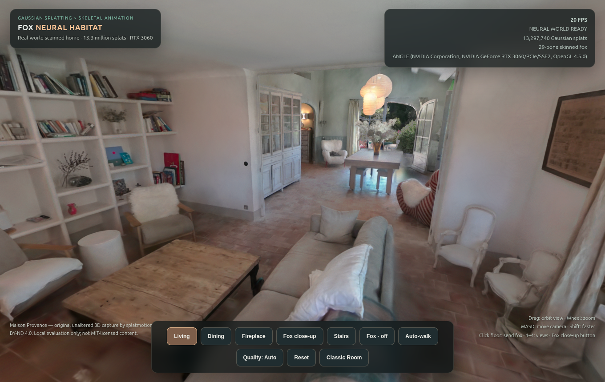

[Second viewpoint: dining room](real3d/docs/v10-neural-room-dining.png)

**Rigged fox — separately illustrated in our original v8 3D room**

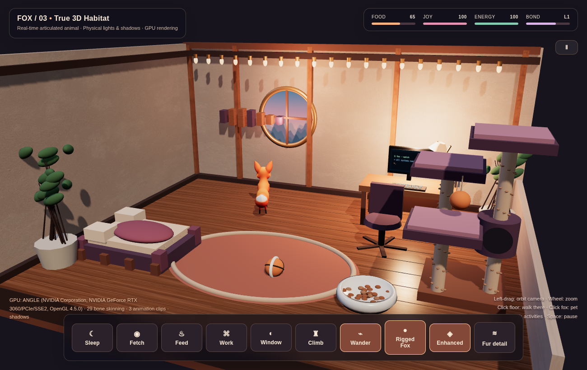

The actual app combines these components locally; the screenshots are presented separately because the house scan's CC BY-ND license does not grant permission to publish an adapted composite. The 3D scan itself is not included in the repository. See [image attribution](real3d/docs/SHOWCASE-CREDITS.md).

A local-only 3D scene built from a photographic scan of a real French house, rendered as 13.3 million Gaussian splats in Spark/Three.js, plus our rigged animated fox. Runs directly on the RTX 3060; verified on Ubuntu X11.

The asset downloader and desktop shortcut are automated; no photos, modeling or manual downloads are required. The previous 3D room is preserved and offers a **Neural World** button.

**[Run and license information](real3d/neural/README.md)**

The original house scan by splatmotion3dgs is CC BY-ND 4.0. It is installed locally only and is **not** distributed in this MIT source repository. The real photographic room plus fox is an experimental local visualization, not a redistributable composite asset.


[**v7: Actual animated demo video**](real3d/docs/v7-enhanced-fox-motion.mp4)


## v8 — Atelier Habitat: Premium Room

The entire 3D cabin has been upgraded with redesigned furniture, bevels, detailed textiles, richer materials and more natural lighting. A proper 3D scene remains interactive and hardware accelerated.

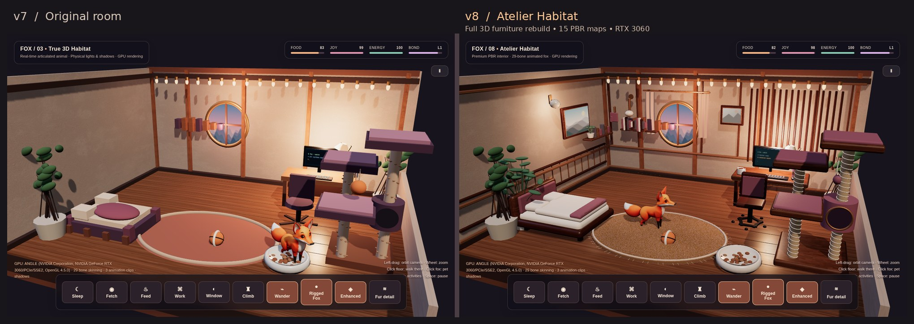

[View real GPU-recorded v8 video](real3d/docs/v8-room-demo.mp4)

## v7 — Textured fox & real PBR environment

- Default 41,822-vertex Bake3D fox with 29-bone skeleton and three native motion clips.
- Improved materials: ambientCG WoodFloor051 and Plaster001 PBR textures.
- Enhanced / Classic rig selector, with procedural IK fallback.
- Open the **Ubuntu Fox — Real 3D** app. The older PyQt version remains available.

## v6 — True 3D Habitat (new)

**A real GPU-rendered 3D scene now exists**, separate from the old 2.5D image-based room.

- Rigged glTF fox: 24 bones with native Survey, Walk and Run animation clips.
- Fully 3D, orbitable furniture and room, real-time shadows, raycast navigation and interaction.
- Toggle between the glTF animation rig and original procedural four-leg IK model.
- Optional experimental 20,000-strand skinned fur shader, off by default due to early visual quality.
- On the development Ubuntu machine, verified WebGL hardware renderer NVIDIA RTX 3060 at ~60 FPS.
- Ubuntu launcher: **Ubuntu Fox — Real 3D**. Instructions: [real3d/README.md](real3d/README.md).

[**Watch actual walking and camera orbit (MP4)**](real3d/docs/real3d-motion-demo.mp4)

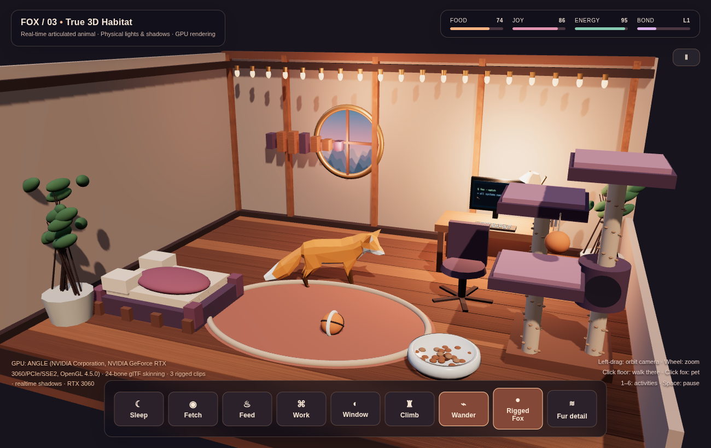

**The 2D PyQt app below remains available and is not replaced.**


**v4 Cozy Room Mode** — a layered interactive home for your animated Linux desktop companion.

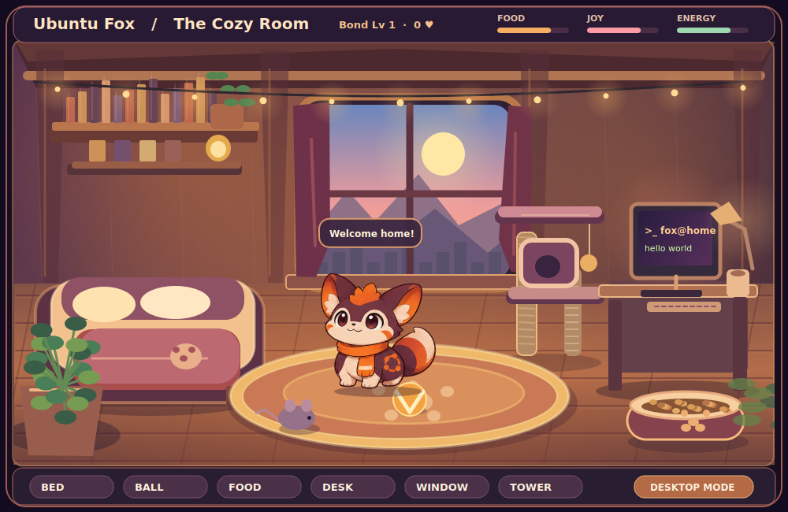

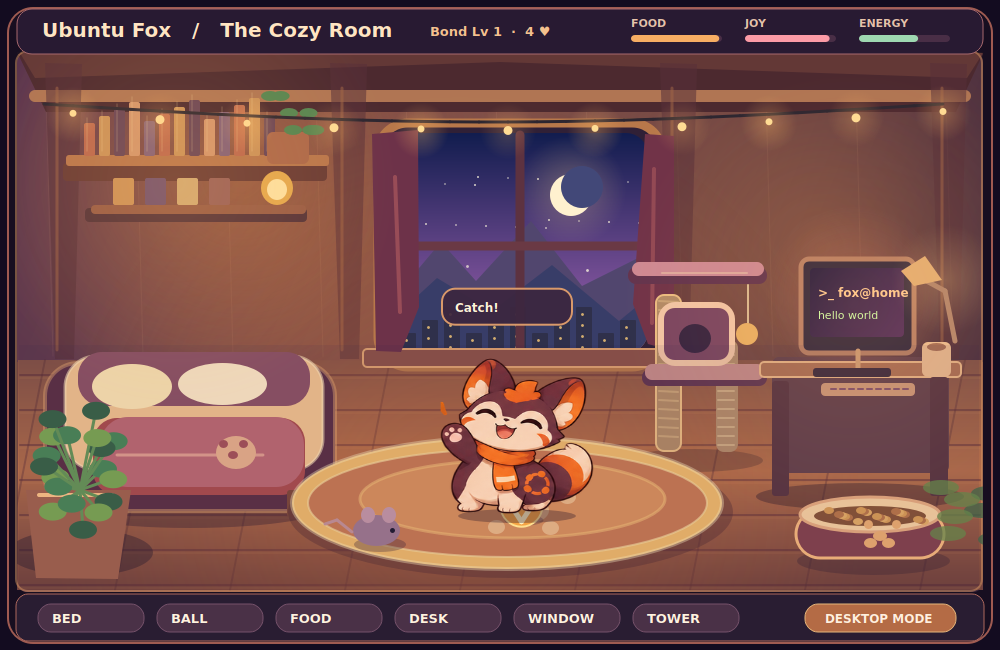

An original, lightweight, animated desktop fox for Ubuntu GNOME and other X11 Linux desktops. No AI model, network access, account, or GPU required.

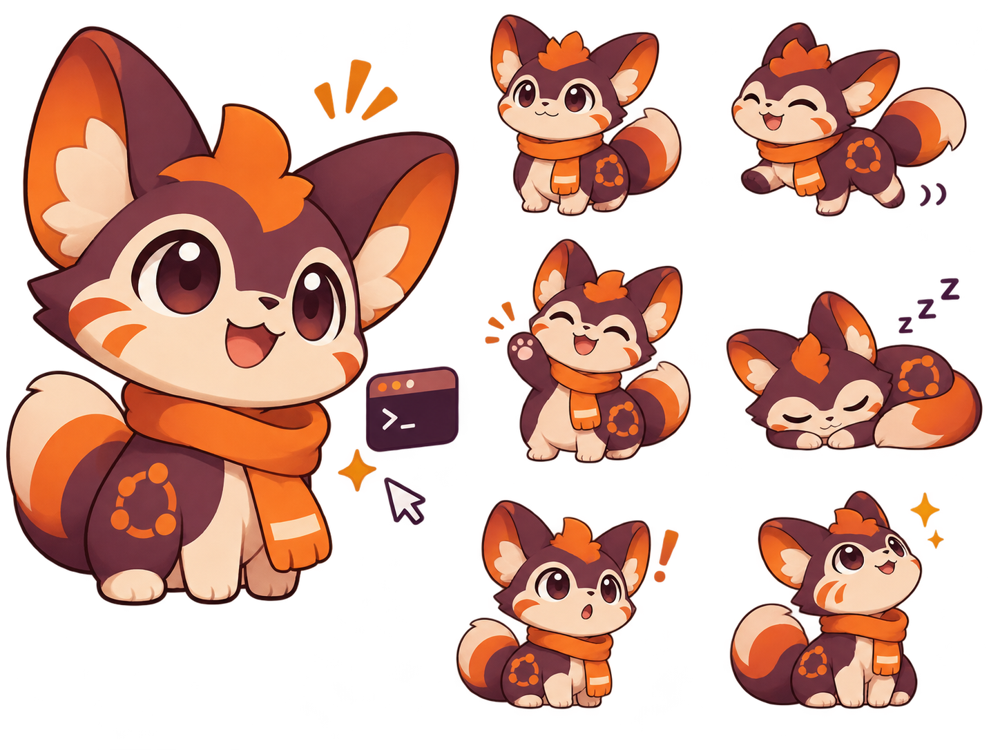

## Features (v4)

- **Cozy Room:** layered 2.5D cabin with bed, ball, food bowl, computer, window and climbing tower
- Click a furniture hotspot and the fox walks over to interact
- Day/night window scenery, warm animated string lights, soft shadows, floor perspective and foreground foliage
- Room status HUD, persistent bond level, local pet needs, floating speech bubbles
- Classic floating pet is preserved; switch freely between Desktop and Room Mode
- All graphics are drawn locally using Qt; no AI model, browser, GPU, account or network needed

### Room controls

| Action | Effect |
|---|---|
| Right-click desktop fox → Open cozy room | Switch to room |
| Click bed | Walk over and sleep |
| Click ball | Play fetch |
| Click food bowl | Eat a treat |
| Click terminal desk | Pretend to code |
| Click window | Gaze outside |
| Click climbing tower | Jump |
| Click anywhere on the floor | Walk there |
| Click the fox | Cuddle and increase bond |
| Esc or DESKTOP MODE | Return to floating fox |
| Space | Play fetch |
| Right-click → Night lighting | Toggle room lighting |

## Classic desktop features

- Six expressive poses: idle, walk, wave, sleep, surprise, and look
- Transparent always-on-top window with drag-to-position
- Click to pet, double-click to play catch, right-click for feeding, sleeping, mood, and settings
- Food, joy, and energy levels that change over time and are saved locally
- Optional mouse-following, wandering, quiet mode, and three window sizes
- Throw the fox gently with the mouse and watch it bounce from desktop edges
- Right-click Jump / Spin or middle-click to jump; hold left button to cuddle
- Earn bond points and levels from pets, treats, and ball catches; track your catches
- Mouse wheel to resize; all animations are self-contained, with no GPU requirement
- Lightweight PyQt6 interface; no background services or telemetry

## v5: Local photorealistic room (experimental)

Ubuntu Fox can use a locally generated 3D-render-style room and realistic fox sprites. The default drawing remains available through **right-click → Photorealistic room** and the floating desktop pet still works.

- Physically shaded wood cabin, photorealistic fur and natural animal proportions
- Eight coherent quadruped walk-cycle frames, blended into the room's continuous positional movement
- Separate realistic idle and sleeping poses, controlled by room hotspots
- No GPU or AI model required during gameplay; all generated outputs are PNGs loaded by PyQt6
- This is **photorealistic 2.5D sprite animation**, not yet a rigged, independently rotatable 3D mesh

**To use the optional local assets:** Generate the four PNGs with a locally licensed Qwen-Image-2.1-Turbo checkpoint, then prepare them:

```bash
python tools/generate_research_assets.py --model-dir /path/to/Qwen-Image-2.1-Turbo --out-dir "$HOME/fox-assets" --only fox_master room_empty walk_sheet sleep_pose
python tools/prepare_research_assets.py --input "$HOME/fox-assets" --install
```

The generator needs a separate environment with compatible CUDA, PyTorch, Diffusers (QwenImage21Pipeline), Transformers, Pillow and NumPy. Asset preparation needs Pillow and NumPy. The app itself requires only PyQt6.

Generated files are installed into `~/.local/share/ubuntu-fox-pet/realistic/`; these files **are not included in this MIT-licensed repository**. The checkpoint used for local evaluation has a **Qwen Research License with non-commercial restrictions**. Model rights, generated-image rights, and any redistribution or commercial use need separate review. Do not upload the model weights or these experimental outputs as MIT-licensed source assets.

## Install

Tested on Ubuntu 24.04 GNOME **X11**.

```bash
sudo apt update
sudo apt install python3-pyqt6
git clone https://github.com/bettercallcaleb/ubuntu-fox-pet.git
cd ubuntu-fox-pet
./install.sh
```

Then open **Ubuntu Fox Pet** from the application launcher, or run `~/.local/share/ubuntu-fox-pet/run.sh`.

**Display support:** GNOME X11 is tested; Wayland behavior varies by compositor, especially global cursor tracking and always-on-top windows.

## Controls

| Action | Result |
|---|---|
| Left-click | Pet the fox; hearts and joy |
| Double-click | Start a ball game |
| Click the ball | Catch it |
| Drag with left button | Reposition; release quickly to toss and bounce |
| Hold left button | Cuddle and collect hearts |
| Middle-click | Jump |
| Mouse wheel | Change size |
| Right-click → Jump / Spin | Perform a trick |
| Right-click → Feed cookie | Increase food |
| Right-click → Show mood & needs | Show three status meters |
| Right-click → Take a nap / Wake up | Control rest |
| Right-click → Follow mouse | Have the fox trail the pointer |
| Right-click → Quiet mode | Suppress speech bubbles |
| Right-click → Quit | Exit |

Preferences, bond points, and catch totals live in `~/.config/ubuntu-fox-pet/state.json` and never leave your machine.

## Uninstall

```bash
rm -rf ~/.local/share/ubuntu-fox-pet ~/.local/share/applications/ubuntu-fox-pet.desktop
```

To delete saved pet state too: `rm -rf ~/.config/ubuntu-fox-pet`.

## Development

```bash
sudo apt install python3-pyqt6
QT_QPA_PLATFORM=offscreen /usr/bin/python3 tests/smoke.py
/usr/bin/python3 pet.py
```

The packaged sprites and icon are stored under `assets/`. `assets/source-sheet.png` is the original AI-generated concept sheet. The app ships with static images and requires no image-generation runtime.

## License and trademark

Licensed under [MIT](LICENSE) for source code and included original artwork. The fox is a fan-made Ubuntu-inspired design; it is **not affiliated with or endorsed by Canonical**. Ubuntu and its logos are trademarks of Canonical Ltd. The project license grants no trademark rights.

Contributions and bug reports are welcome.
