# FOX / 18 — Anatomical forward alignment and neutral head correction

The GLB realistic fox is modeled with **local +Z forward** (measured from the hips-to-head bind-pose joint positions); the Three.js animal movement and IK math assume **world +X forward**. An incorrect 180-degree holder rotation introduced in v16.1 made these axes perpendicular, leaving the fox walking sideways even though navigation tests and the camera facing numerically passed. In v18, the holder uses a single `REALISTIC_MOUNT_YAW = Math.PI / 2` constant and correct 0.4-radian head/neck local-Y neutral pose adjustments. The model's skinned head and body can now face and walk in the same direction rather than twisting the torso to compensate.

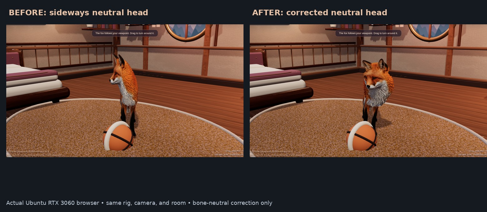

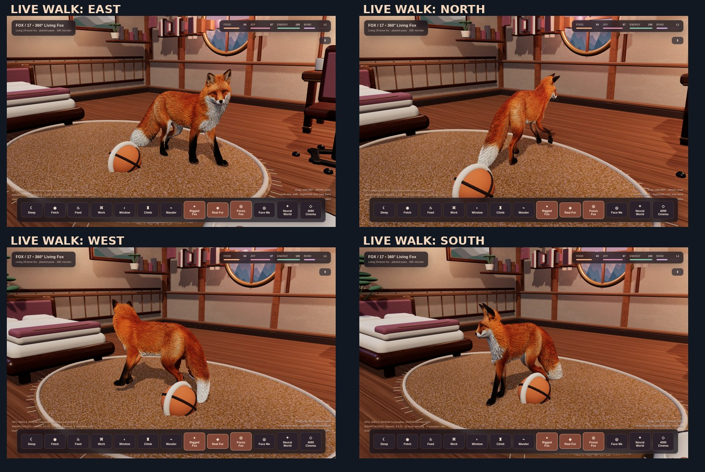

[**12.4-second live RTX 3060 four-direction walking video**](docs/v18-correct-anatomical-walk.mp4)

`check-fox-axis-v18.mjs` reads **the actual GLB inverse bind matrices** (not just intended math) to verify the local forward axis, foot order and transformed forward direction for all four cardinal directions. Browser captures verified the head-to-hips vector matches the movement vector (direction cosine >= 0.9993), no JS exceptions, and 59–60 FPS on RTX 3060. v17's in-place foot contact corrections remain active. Historical v16.1 screenshots and 180-degree rotation discussion are retained only to document the rejected workaround.

# FOX / 17 — Stable full-body turning

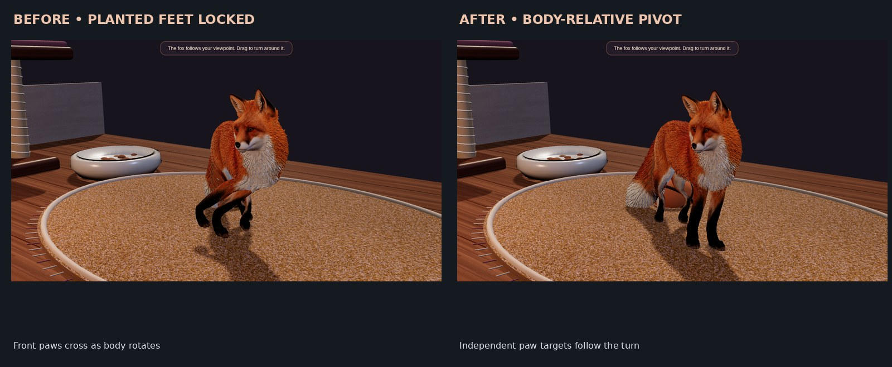

[**See actual corrected animation: 12.6-second live Ubuntu RTX 3060 recording**](docs/v17-turn-stable-real-time.mp4)

When `Face Me` rotates a 29-bone skinned fox in place, the old world-planted foot targets remained static while the pelvis rotated. The IK algorithm pulled its paws across the other side of the body (up to 0.173 scene units toe-target error), producing the visibly implausible twisted-body screenshots. In v17, in-place turns use `turn-contact-v17.js`: the four contacts smoothly follow their body-relative home positions with a small lift to suggest stepping. Normal travel keeps the existing stance/swing cycle. The secondary-motion controller reduces head twist while the body pivots. The underlying realistic fox mesh, fur system and 29-bone rig remain unchanged.

`node check-turn-v17.mjs` simulates a full rotation in either direction at 15/30/60/120 FPS, verifies each paw stays on its anatomical side, tracks the body within a small bound and remains grounded. The RTX 3060 browser stress test covered six camera turns (96 samples) and a walking transition, showing no JavaScript exceptions, max 0.0051 toe error and minimum 56 FPS. Human-visible screenshots and video were captured from the running application, not synthetic renders.

## v16.1 — Correct the actual visible animal orientation

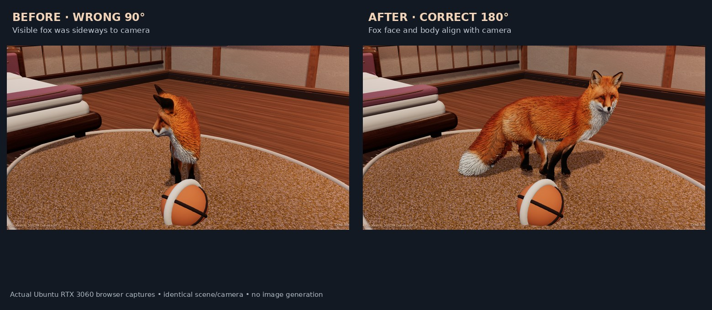

**Superseded:** This section originally claimed the realistic mesh required a 180° mount. That was incorrect: the anatomical GLB forward axis is local +Z and requires **90°** to match world +X. v18 restores 90° for all variants and uses independent head/neck neutral corrections. The remaining v16.1 null-attention-vector fix is valid. The `Face Me` frame loop also tried to call `.set()` on null `fox.attentionPoint`, throwing repeatedly before updating orientation. Both defects are corrected. The game starts with Face Me on; users can deliberately switch to autonomous Wander.

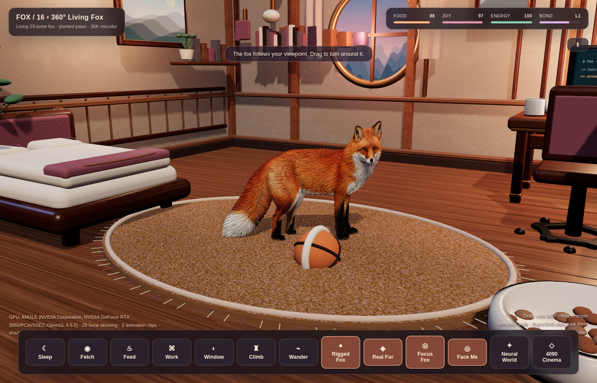

[**Watch a recorded camera orbit with corrected facing**](docs/v16-face-me-model-correction.mp4)

# FOX / 16 — Full-Direction Looking and Turning

## v16 — Free 360-degree camera orbit + fox look control

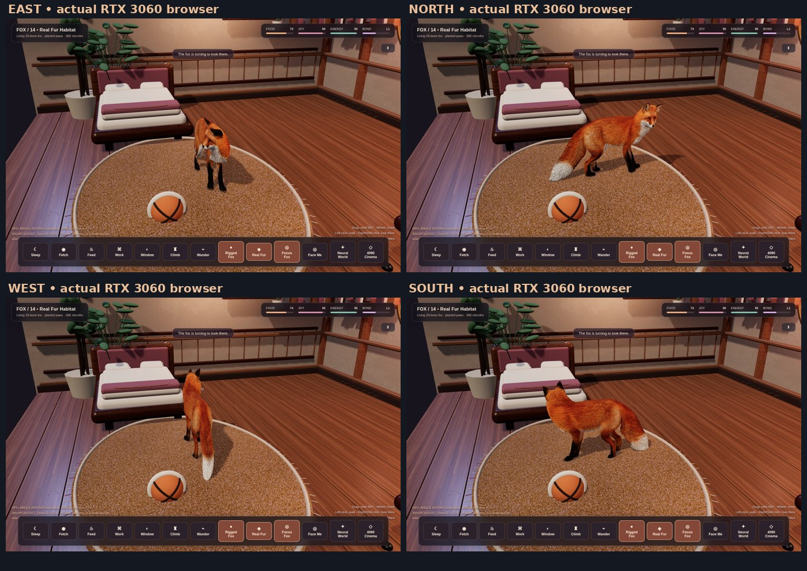

[**Watch real-time four-direction turning**](docs/v16-fox-full-direction-demo.mp4)

The restricted camera orbit was limited to approximately 142 degrees. The fix now allows **full 360-degree mouse orbit**, and adds explicit body/head tracking: **Face Me** toggle or **L** key makes the fox continuously turn toward the camera; **right-click** or **Shift+left-click** on the floor tells the fox to turn toward any world point without walking. The fox also glances toward the cursor while idle. Ordinary left-click walking, fur, posture animation, IK and existing tasks are preserved.

`fox-facing-v16.js` centralizes shortest-arc yaw calculations and the world-space look direction. `check-facing-v16.mjs` checks four compass directions, wrap at +/-180 degrees and reversible 720-degree camera orbit. Live Chrome DevTools tests also verified body/nose alignment, Face Me tracking and right-mouse interaction at roughly 60 FPS on RTX 3060.

# FOX / 15 — Fox that actually moves

## v15 — Re-fitted skeleton, real quadruped gait, real postures

Why the fox was stiff: the shipped `Fox_Realistic_Rigged.glb` mesh was sculpted mid-stride and slightly bent (tail and hips drifted to +x, head to -x) while the 29-bone skeleton lay on a straight x=0 line. The front-leg bones sat ~0.15 behind the real legs, the right hind leg had **zero** skinned vertices, and the neck/ears/right hind bones had none either. Any bone rotation swung geometry around the wrong pivot, so the earlier motion layer had to stay tiny and everything looked rigid or broken.

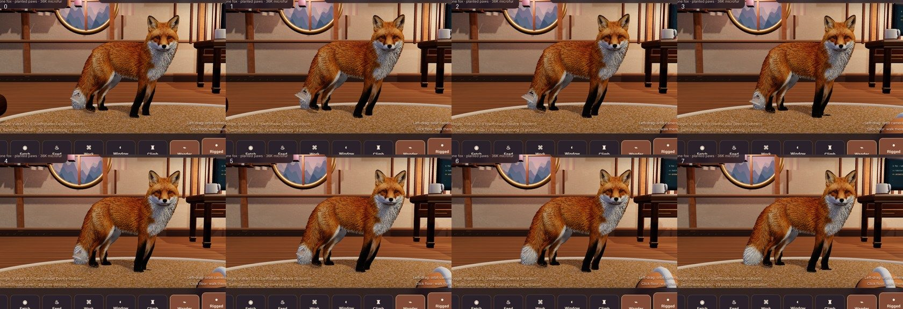

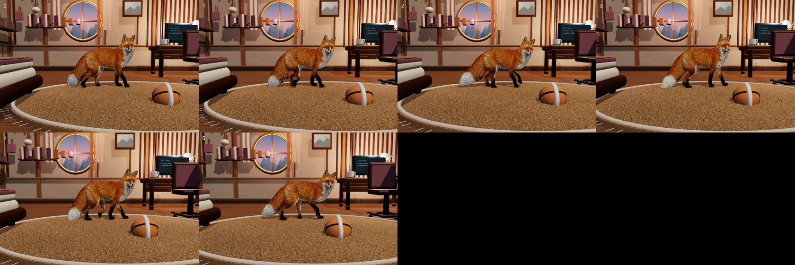

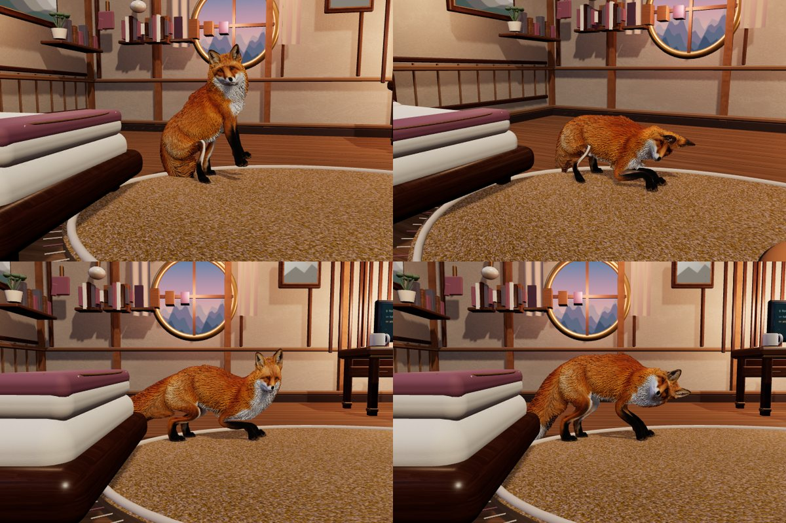

- **Asset refit** (`tools/refit_realistic_fox.py`, numpy only, reproducible from the original GLB): unbends the mesh along its own centreline, moves all 28 joints to anatomical positions measured on that mesh (inverse bind matrices and node translations recomputed; names, hierarchy, rotations and animations untouched) and re-skins by distance-to-bone-segment with side and height rules, so leg bones never pull the back or the opposite flank. Ears sit at the real ear positions.
- **Pose kit** (`fox-rig-v15.js`): semantic fox-space posing (pitch/yaw/roll about the animal's own axes, independent of Blender's bone axes), analytic two-bone IK and shortest-arc aiming.
- **Gait** (`grounded-gait-v13.js`): lateral-sequence walk (LH, LF, RH, RF; 70% duty), phase driven by the distance actually travelled so planted paws do not skate, stepping in place when turning, flat front paws and flexing hocks, paw targets for lying/sitting/play/jump relative to the rig's own home positions.
- **Living motion** (`living-motion-v14.js`): real posture weights for sleep (lying), sit, sniff/eat, play-bow and jump with spine, neck, head, ear and tail chains; a move gate lets the fox stand up before walking away.
- Fixed `bed` vs `sleep` action mismatch in `scene.js` so the bed task really lies down.

Measured in a software-GL headless run (no real-GPU timing): walk contact error mean ≈ 0.012 / max ≈ 0.14 scene units across 5 s, 7–8 swings on each leg, all bone quaternions finite in every posture, `check-v14-live.mjs` contact error max 0.005 with no console errors.

Offline checks: `node check-assets.mjs && node check-rig-fit.mjs && node check-v13.mjs && node check-v14.mjs` (`check-rig-fit.mjs` fails on the original asset: body 0.14 off the skeleton axis). Live check as in v14.

# FOX / 14 — Living Fox Habitat

## v14 — Expressive secondary motion instead of a rigid fox

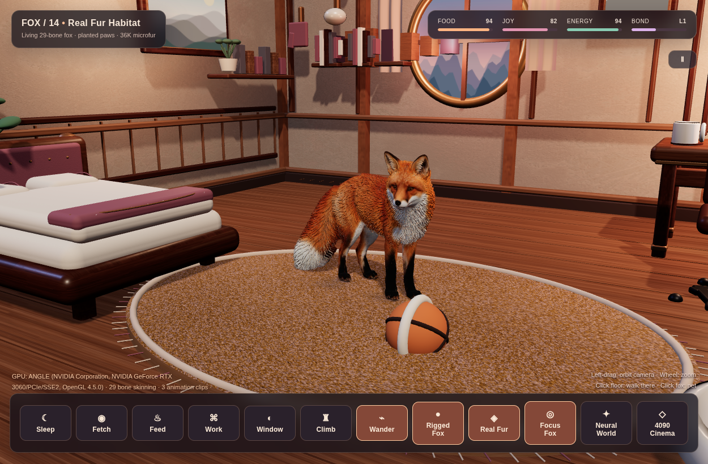

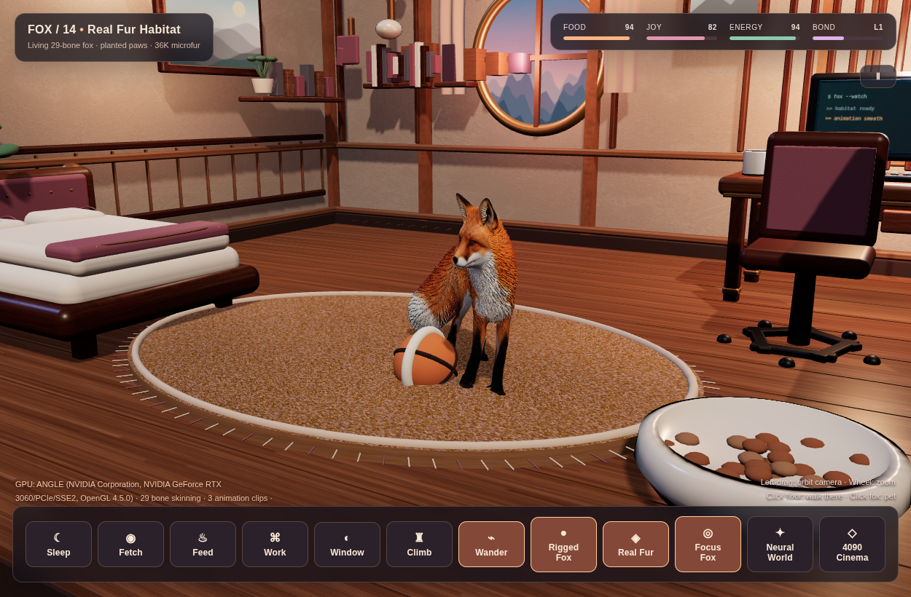

[Watch the RTX 3060 live 7.5-second motion capture](docs/v14-living-fox-motion.mp4)

- A 29-bone secondary-motion controller adds smooth look-around, head pitch, intermittent sniffing, independent ear flicks, breathing, torso counter-motion, and delayed tail wag tied to walking, turning, playing, feeding, and sleeping.
- Replaced oversized procedural strands with 36,000 short microfur ribbons anchored directly to the high-resolution fox mesh's existing skin weights. Face, paws, and muzzle remain visually legible.
- Adjusted body height and paw swing to reduce observed maximum toe-target error in the walking test from approximately 0.156 to 0.102 scene units; no claim of physically exact contact.
- Current app remains a locally rendered Three.js scene with the original CC0 high-resolution fox, the existing 29-bone rig, unchanged task navigation and furniture.
- Validated in the actual Ubuntu/RTX 3060 Chrome scene: approximately 60 FPS, no JavaScript exceptions, animated idle/walk/play states. Video and PNGs are real app screenshots rather than generated concept art.

For offline checks: `node check-v13.mjs && node check-v14.mjs`. For the actual browser test, launch Chrome with `--remote-debugging-port=9222` and run `FOX_CDP_PORT=9222 node check-v14-live.mjs`. The capture tool `tools/capture-v14-motion.mjs` uses the same CDP port.

# FOX / 13 — Grounded Fox Habitat

## v13 — Planted paws, safer navigation, richer interactions

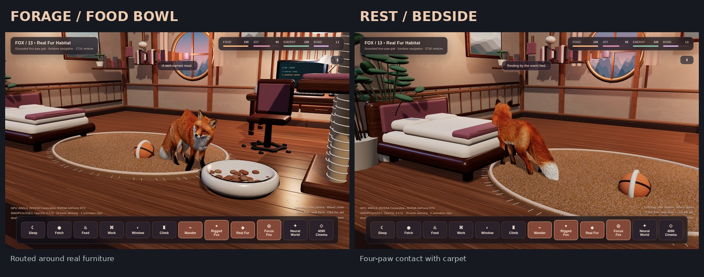

[**Watch actual 12.7-second RTX 3060 live 3D recording**](docs/v13-grounded-fox-interactions.mp4)

- The realistic fox uses independent diagonal gait phases, stance and swing contacts, a smooth lifted swing trajectory, anatomically limited iterative bone IK, and a body height model that responds to the raised rug and wooden floor.
- Four GPU-friendly contact shadows follow the true 3D toe locations. During swing, the corresponding shadow softens. The system maintains the original 29-bone glTF skin and CC0 textured realistic mesh.
- **A* route planning plus line-of-sight smoothing** keeps the animal clear of the bed, desk, office chair, food bowl and cat tower. All six original task buttons remain usable.
- The fox approaches furniture from reachable locations and turns toward the interacted object. Food gives a brief head dip, petting produces ear/tail movement, and resting softens the body pose.
- The original Real Fur / Enhanced / Classic toggles, PBR room, auto-wander, furniture clicking and close-follow camera remain available.

On Ubuntu X11 / RTX 3060, the new interactive scene maintained around **60 FPS at 1300×820** in our browser test, with no uncaught JavaScript errors. Navigation and ground contact remain approximate; this is not a full solid-body collision simulator. Static clearance tests and a live walking/activity test are included.

**Technical files:** grounded-gait-v13.js, navigation-v13.js, check-v13.mjs. No GPU training, external API, or additional proprietary asset is required.

# FOX / 12 — Real Fur Habitat

## v12 — Realistic fox, vertex skinning, real-time quadruped gait

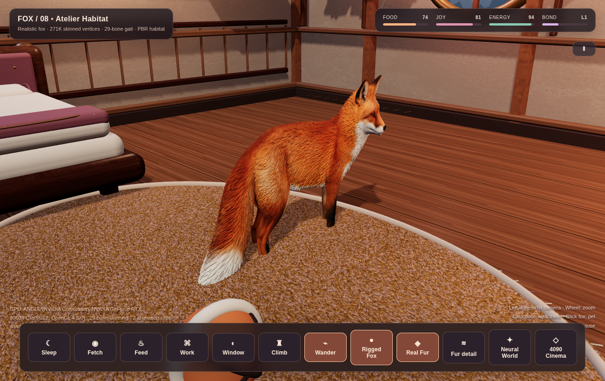

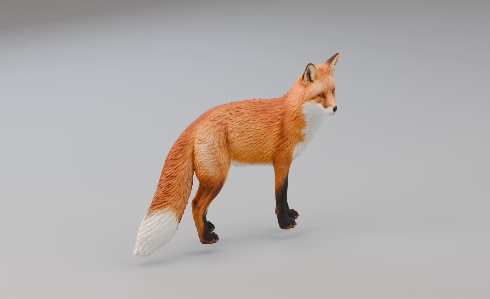

[8-second live 3D quadruped gait recording](docs/v12-real-fox-animation.mp4)

The default animal uses 271,221 high-resolution mesh vertices from a CC0 realistic fox, retargeted using Blender to the existing Bake3D 29-bone armature (CC BY 4.0). Unlike sprites, its surface deforms with the skeleton. The initial source animations distorted the realistic geometry, so the app now uses directly animated bone quaternions with blended quadruped gait, subtle head motion, ears and tail.

The new Focus Fox camera tracks the animal through the room. Press F or the Focus Fox button to return to the room overview. The original furniture, camera and pet interactions remain usable. Use the character button to cycle Real Fur → Enhanced → Classic. RTX 3060 real-time rendering remains supported. An 1800×1100 OptiX asset preview of this same character was produced on RTX 4090.

Rebuild the generated asset after downloading the CC0 light GLB from https://grab3d.com/models/animals/fox/ :

    blender -b -P real3d/tools/rig_realistic_fox.py -- real3d/assets/Fox_Enhanced.glb /path/to/fox-light.glb real3d/assets/Fox_Realistic_Rigged.glb

License and source references: [assets/CREDITS.md](assets/CREDITS.md).

# FOX / 08 — Atelier Habitat

## v11: Separate RTX 4090 Neural Cinema and live editable 4D Studio

[**Watch actual on-device NVIDIA RTX 4090 demo footage**](rtx4090/README.md). Video/gallery and original 4D source studio are accessible from the Ubuntu application menu. Source-art files are deliberately excluded from this repository. The original v8 room and 3060 neural environment are untouched.

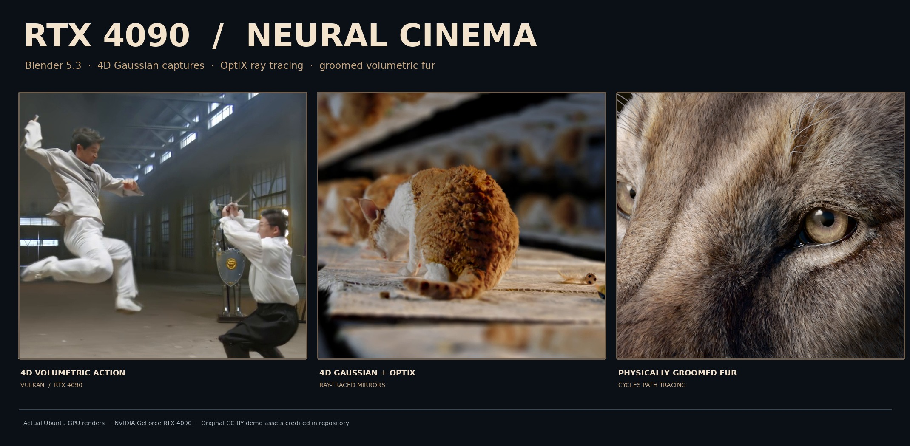

## v10 Neural Habitat — optional local-only experience

[**Instructions and licenses**](neural/README.md). The new **Neural World** button switches to the Spark / Gaussian Splatting demo: real scanned home, 13.3 million splats, and the same 29-bone fox. Original 3D cabin remains playable. The scan downloads during local installation but is excluded from GitHub.

**[Watch the 8-second real 3D motion demo](docs/real3d-motion-demo.mp4)** — recorded from the actual Ubuntu X11/RTX 3060 window at 30 FPS.

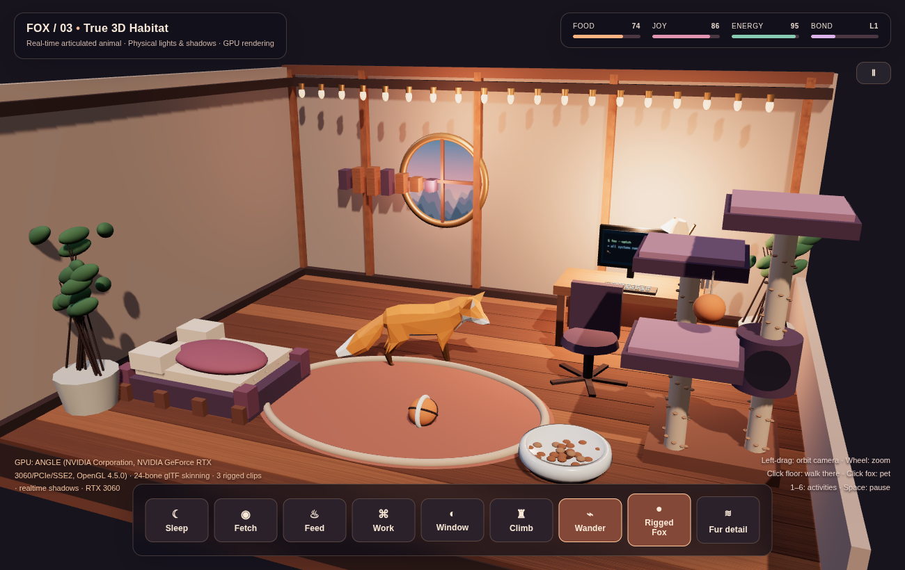

A real-time, hardware-accelerated 3D room with a rigged, skinned textured fox, not a moving 2D sprite.

Built with Three.js and WebGL 2. The default textured fox has 29 skeletal joints and three animation clips (Walk, Tail wag, Look around); the Classic alternative has 24 joints. The runtime changes animation clips when the fox navigates. A second procedural fox with articulated legs and analytical two-bone IK is available through the Rigged Fox / IK Fox button.

[**Watch v7 actual RTX 3060 motion capture (MP4)**](docs/v7-enhanced-fox-motion.mp4)

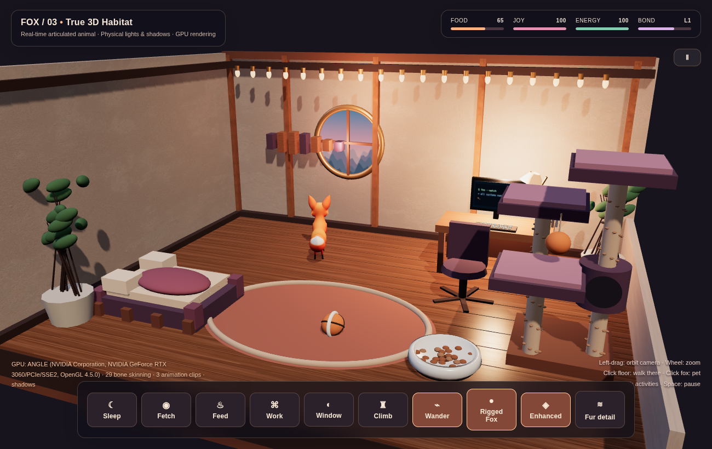

## v8 — Premium interior rebuild

- Rebuilt the pet bed, workstation, leather chair, climbing tower, and woven rug using softened/beveled 3D furniture meshes.
- Expanded from six to **15 PBR material maps**, including fabric, carpet fibers, and leather (ambientCG, CC0).
- Added wooden wall paneling, skirting, curtains, gallery art, shelves, plants, a table lamp, fabric seams and rope-wrapped posts.
- Rebalanced cool daylight and warm interior lighting, added localized contact shadows, and retained full camera freedom and room interactions.
- Tested in Chrome on the RTX 3060: **60 FPS at 1300×820** during the benchmark, no uncaught JavaScript exceptions.

See the [v8 comparison image](docs/v8-comparison.jpg) and [v8 motion recording](docs/v8-room-demo.mp4).

## v7 — Enhanced rig and PBR environment

The default fox now uses the Bake3D textured GLB: **41,822 vertices, 29 bones, Walk / Tail wag / Look around**. The glTF skeleton animates the 3D geometry; animation-to-navigation speed is tuned for reduced foot sliding. Switch between **Enhanced** and **Classic** in the bottom toolbar.

The cabin floor and plaster walls use **1K PBR maps** (albedo, normal and roughness) under dynamic GPU lighting. The previous fox remains in the app as a fallback, and the procedural IK version remains available.

Source assets are freely licensed for redistribution with their own terms; credits are documented in [assets/CREDITS.md](assets/CREDITS.md).

## Ubuntu 24.04 installation

    cd real3d
    ./install.sh
    ./launch.sh

The installer adds an Ubuntu Fox — Real 3D application entry. Chrome/Chromium, Python 3, and Node.js/npm are required for setup. The running application does not invoke an AI image generator or an LLM.

## Controls

- Left-drag anywhere: orbit the 3D camera; mouse wheel: dolly zoom.
- Click empty floor: fox walks to the chosen 3D point.
- Click the fox: pet and gain bond points.
- Buttons or keys 1–6: bed, fetch, food, computer, window, climbing tower.
- Rigged Fox: switch between glTF skinning and procedural four-leg IK.
- Wander: toggle autonomous wandering.
- Space: pause; F: reset camera; D: GPU/FPS debug overlay.

The scene uses actual 3D floor planks, walls, furniture, dynamic shadows, perspective and raycasting. The bundled rigged model is an intentionally lightweight low-poly validation asset; this is **not yet a production-grade photoreal animal**.

The Fur detail button adds 20,000 triangle-based fiber strands that inherit the source mesh's skeletal weights. This GPU-skinning experiment is off by default because its visual quality is still being tuned.

## Hardware verification

On the developer's Ubuntu machine, Chrome reported the NVIDIA GeForce RTX 3060 via ANGLE/OpenGL 4.5 and WebGL 2.0. Runtime evaluation verified 24 skinning joints, the three animation clips, foreleg and spine joint rotation during walking, and about 60 FPS in the active room.

Results depend on the GPU, drivers, compositor, browser and resolution. The application requests high-performance graphics but does not force a particular GPU on every machine.

## Licensing

The source is MIT licensed. The included glTF model has CC0 and CC BY 4.0 attribution; see assets/CREDITS.md. No generated Qwen-Image research assets are distributed.
