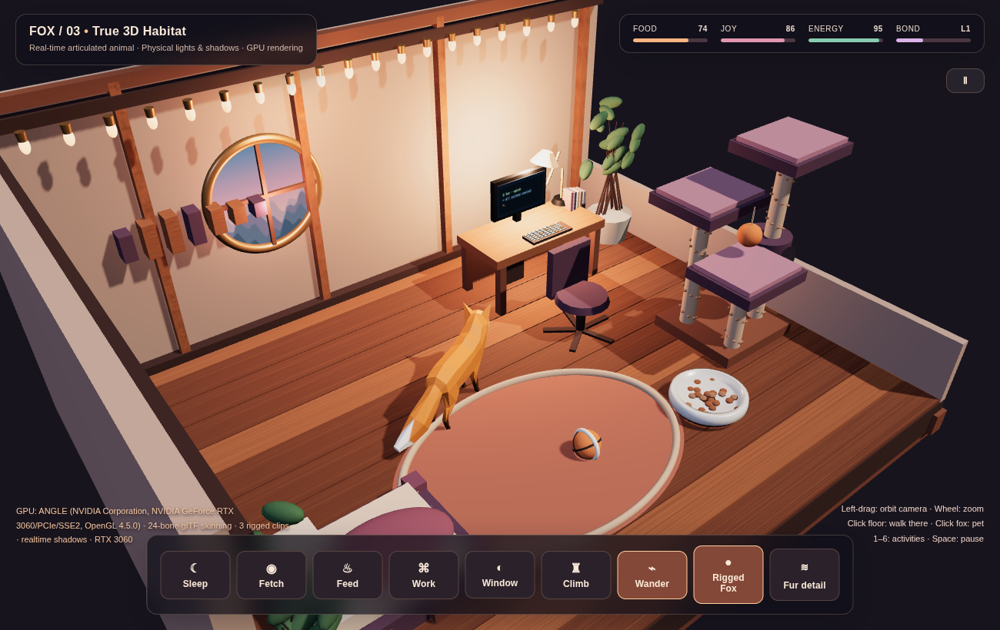

# FOX / 12 — Real Fur Habitat

## v12 — Realistic fox, vertex skinning, real-time quadruped gait

[8-second live 3D quadruped gait recording](docs/v12-real-fox-animation.mp4)

The default animal uses 271,221 high-resolution mesh vertices from a CC0 realistic fox, retargeted using Blender to the existing Bake3D 29-bone armature (CC BY 4.0). Unlike sprites, its surface deforms with the skeleton. The initial source animations distorted the realistic geometry, so the app now uses directly animated bone quaternions with blended quadruped gait, subtle head motion, ears and tail.

The new Focus Fox camera tracks the animal through the room. Press F or the Focus Fox button to return to the room overview. The original furniture, camera and pet interactions remain usable. Use the character button to cycle Real Fur → Enhanced → Classic. RTX 3060 real-time rendering remains supported. An 1800×1100 OptiX asset preview of this same character was produced on RTX 4090.

Rebuild the generated asset after downloading the CC0 light GLB from https://grab3d.com/models/animals/fox/ :

    blender -b -P real3d/tools/rig_realistic_fox.py -- real3d/assets/Fox_Enhanced.glb /path/to/fox-light.glb real3d/assets/Fox_Realistic_Rigged.glb

License and source references: [assets/CREDITS.md](assets/CREDITS.md).

# FOX / 08 — Atelier Habitat

## v11: Separate RTX 4090 Neural Cinema and live editable 4D Studio

[**Watch actual on-device NVIDIA RTX 4090 demo footage**](rtx4090/README.md). Video/gallery and original 4D source studio are accessible from the Ubuntu application menu. Source-art files are deliberately excluded from this repository. The original v8 room and 3060 neural environment are untouched.

## v10 Neural Habitat — optional local-only experience

[**Instructions and licenses**](neural/README.md). The new **Neural World** button switches to the Spark / Gaussian Splatting demo: real scanned home, 13.3 million splats, and the same 29-bone fox. Original 3D cabin remains playable. The scan downloads during local installation but is excluded from GitHub.

**[Watch the 8-second real 3D motion demo](docs/real3d-motion-demo.mp4)** — recorded from the actual Ubuntu X11/RTX 3060 window at 30 FPS.

A real-time, hardware-accelerated 3D room with a rigged, skinned textured fox, not a moving 2D sprite.

Built with Three.js and WebGL 2. The default textured fox has 29 skeletal joints and three animation clips (Walk, Tail wag, Look around); the Classic alternative has 24 joints. The runtime changes animation clips when the fox navigates. A second procedural fox with articulated legs and analytical two-bone IK is available through the Rigged Fox / IK Fox button.

[**Watch v7 actual RTX 3060 motion capture (MP4)**](docs/v7-enhanced-fox-motion.mp4)

## v8 — Premium interior rebuild

- Rebuilt the pet bed, workstation, leather chair, climbing tower, and woven rug using softened/beveled 3D furniture meshes.
- Expanded from six to **15 PBR material maps**, including fabric, carpet fibers, and leather (ambientCG, CC0).
- Added wooden wall paneling, skirting, curtains, gallery art, shelves, plants, a table lamp, fabric seams and rope-wrapped posts.
- Rebalanced cool daylight and warm interior lighting, added localized contact shadows, and retained full camera freedom and room interactions.
- Tested in Chrome on the RTX 3060: **60 FPS at 1300×820** during the benchmark, no uncaught JavaScript exceptions.

See the [v8 comparison image](docs/v8-comparison.jpg) and [v8 motion recording](docs/v8-room-demo.mp4).

## v7 — Enhanced rig and PBR environment

The default fox now uses the Bake3D textured GLB: **41,822 vertices, 29 bones, Walk / Tail wag / Look around**. The glTF skeleton animates the 3D geometry; animation-to-navigation speed is tuned for reduced foot sliding. Switch between **Enhanced** and **Classic** in the bottom toolbar.

The cabin floor and plaster walls use **1K PBR maps** (albedo, normal and roughness) under dynamic GPU lighting. The previous fox remains in the app as a fallback, and the procedural IK version remains available.

Source assets are freely licensed for redistribution with their own terms; credits are documented in [assets/CREDITS.md](assets/CREDITS.md).

## Ubuntu 24.04 installation

    cd real3d
    ./install.sh
    ./launch.sh

The installer adds an Ubuntu Fox — Real 3D application entry. Chrome/Chromium, Python 3, and Node.js/npm are required for setup. The running application does not invoke an AI image generator or an LLM.

## Controls

- Left-drag anywhere: orbit the 3D camera; mouse wheel: dolly zoom.
- Click empty floor: fox walks to the chosen 3D point.
- Click the fox: pet and gain bond points.
- Buttons or keys 1–6: bed, fetch, food, computer, window, climbing tower.
- Rigged Fox: switch between glTF skinning and procedural four-leg IK.
- Wander: toggle autonomous wandering.
- Space: pause; F: reset camera; D: GPU/FPS debug overlay.

The scene uses actual 3D floor planks, walls, furniture, dynamic shadows, perspective and raycasting. The bundled rigged model is an intentionally lightweight low-poly validation asset; this is **not yet a production-grade photoreal animal**.

The Fur detail button adds 20,000 triangle-based fiber strands that inherit the source mesh's skeletal weights. This GPU-skinning experiment is off by default because its visual quality is still being tuned.

## Hardware verification

On the developer's Ubuntu machine, Chrome reported the NVIDIA GeForce RTX 3060 via ANGLE/OpenGL 4.5 and WebGL 2.0. Runtime evaluation verified 24 skinning joints, the three animation clips, foreleg and spine joint rotation during walking, and about 60 FPS in the active room.

Results depend on the GPU, drivers, compositor, browser and resolution. The application requests high-performance graphics but does not force a particular GPU on every machine.

## Licensing

The source is MIT licensed. The included glTF model has CC0 and CC BY 4.0 attribution; see assets/CREDITS.md. No generated Qwen-Image research assets are distributed.
