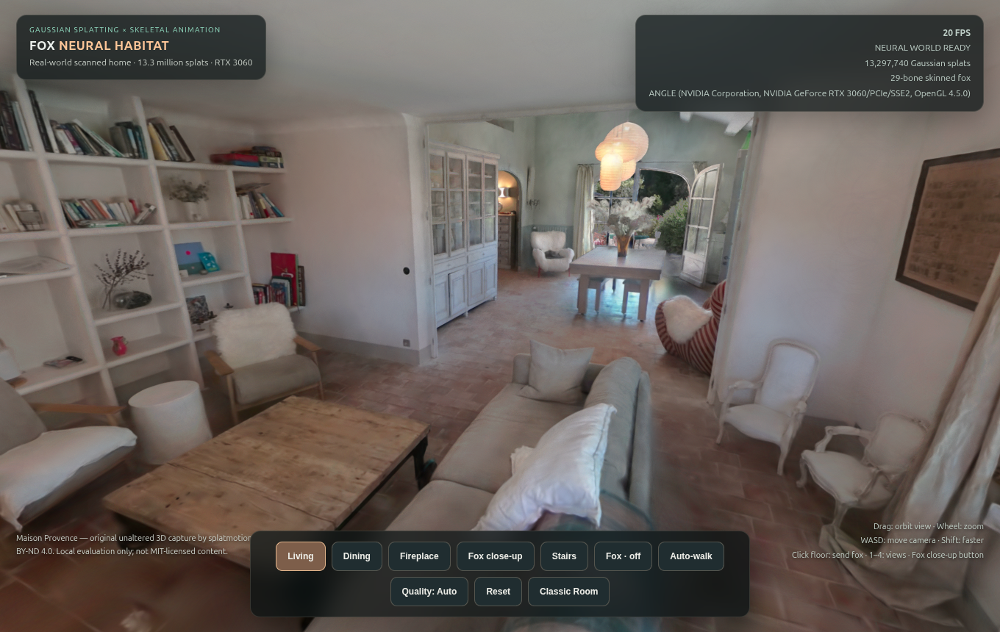
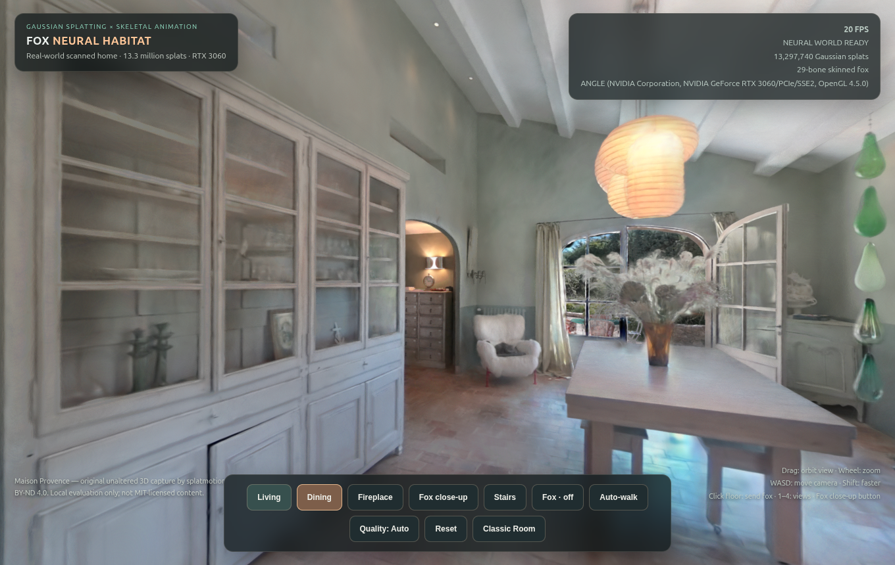

# Fox Neural Habitat — Local RTX 3060 hybrid demo

For experimental RTX 4090 4D Gaussian ray-tracing and high-detail fur demonstrations, see the separate [Neural Cinema gallery](../rtx4090/README.md).

## Screenshots from Ubuntu RTX 3060

The animal is rendered as a separate skinned 3D layer in the live application. It is intentionally hidden in these published screenshots to avoid distributing an adapted version of the CC BY-ND photographically scanned environment. [Attribution and image terms](../docs/SHOWCASE-CREDITS.md).

For the separately displayed animated fox, see [v7 live 3D render](../docs/v7-enhanced-fox-pbr.png).

The neural demo combines a genuine **13,297,740-Gaussian** photographic scan of a furnished French home with the existing **29-bone animated glTF fox** in one Three.js / Spark renderer.

This is a separate, optional experimental room. The v8 cabin, its interactive furniture, the original PyQt pet and the user's saved configuration remain intact.

## Zero-manual-asset installation on Ubuntu

From the repository root:

    ./real3d/neural/install.sh
    ./real3d/neural/launch.sh

Installation downloads dependencies and the legally attributed original scan automatically. It installs a desktop menu shortcut, **Ubuntu Fox — Neural Habitat**. After first installation, assets are served locally from the Ubuntu machine; there are no external runtime API requests.

The room can also be opened from **Neural World** in the original v8 3D application, with **Classic Room** linking back.

### Controls

- **Living / Dining / Fireplace / Stairs**: photographic scene viewpoints.
- **Fox close-up**: camera near the skeletal fox.
- Drag: orbit the camera. Wheel: dolly zoom.
- WASD / arrow keys: move camera.
- Click a location on the ground: instruct the fox to walk there.
- **Auto-walk**: automatic wandering. **Fox on/off**: toggle the animal.
- **Quality**: cycle Auto / Performance / Cinema.

### Local hardware validation

On the development Ubuntu/X11 machine with an RTX 3060 12GB, the original scan and skinned fox successfully render together. Browser reports WebGL 2 backed by NVIDIA GeForce RTX 3060, 13.3 million loaded splats and the 29-bone animated fox. Interactive FPS depends on view, other GPU workloads and quality mode; the large scan reached around 30 FPS at 1360×860 in the active desktop test. Higher modes are optional, not promises.

This is an **experimental hybrid visualization**, not a physically accurate collision simulator. Photographic furniture and walls can obscure the fox and the contact proxy is approximate. The fox is still the stylized Bake3D asset, not a photoreal model.

### Source and licensing — important

- **Rendering framework**: Spark (https://github.com/sparkjsdev/spark), MIT license.
- **Photographic 3D scene**: Maison Provence by splatmotion3dgs (https://superspl.at/user/splatmotion3dgs), distributed from open-house-studio (https://github.com/wilsonwu-ai/open-house-studio) at pinned commit 2e177c95686fb078509e6143a8719bc32a77a551, original scan **CC BY-ND 4.0**. The scan is stored locally and **is not part of this Git repository**. Preserve original author and licensing; do not redistribute modified scan or composite derivative content.
- **Skeletal fox**: Bake3D, CC BY 4.0; see ../assets/CREDITS.md.

The install script creates a SOG ZIP container of the original, unaltered WebP splat-attribute files for Spark interoperability. The original attribute data is unchanged. This is for local evaluation, not a claim that the original capture is MIT-licensed or that publication of derivatives is permitted.

The 137 MB local SOG file lives at ~/.local/share/ubuntu-fox-pet/neural/maison-provence.sog, not alongside public source code. Clone code, run install, and let it download itself. Do not check the SOG, screenshots or recordings of the composite scene into public source control.
