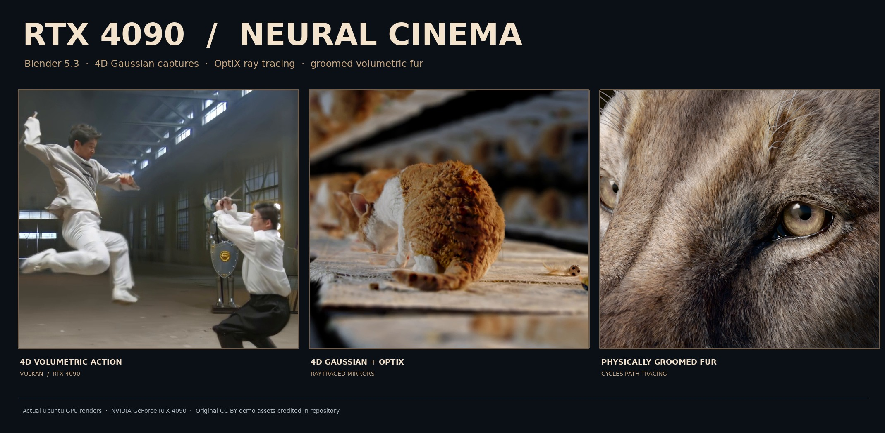
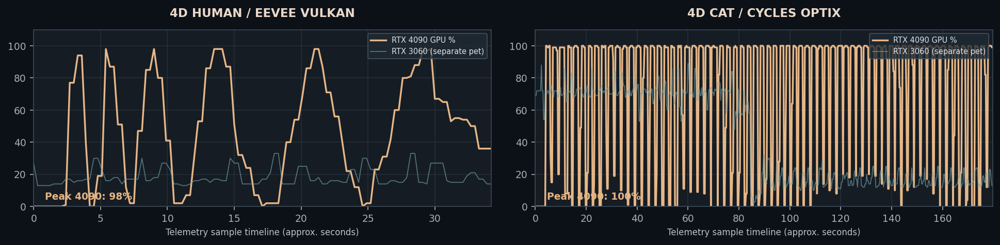

# RTX 4090 Neural Cinema Lab

An actual NVIDIA RTX 4090 rendering experiment on Ubuntu 24.04. The three demos show real-world dynamic 4D Gaussian captures, 4D Gaussian volumes reflected by a path tracer, and an animal close-up with groomed geometric hair. All visuals below were rendered on the local RTX 4090; they are not synthetic stills generated in a chat.

## Actual captured GPU outputs

| Demo | Technology | Media |
|---|---|---|
| 4D martial arts | Time-varying Gaussian capture, Blender 5.3 EEVEE + Vulkan | [5-second / 120-frame video](media/4090-human-4dgs.mp4) |
| Infinite mirrors + dynamic cat | 4D Gaussian volume, secondary rays, Blender Cycles + GPU OptiX | [3.33-second / 80-frame video](media/4090-cat-cycles-4d.mp4) |
| Panthera spelaea | Individual groomed fur geometry, physically-based lighting, Cycles + GPU OptiX | [1600 × 800 still](media/4090-panthera-optix.png) |

### Hardware and rendering measurements, November 11, 2026

| Scene | Frames / size | Offline render duration | 4090 peak utilization | Peak VRAM | Peak power |
|---|---|---:|---:|---:|---:|
| 4D martial arts | 120, 1280×600 | 32.21 sec | 98% | 1,463 MiB | 277 W |
| 4D cat, ray-traced mirrors | 80, 1152×540 | 203.14 sec | 100% | 3,446 MiB | 342 W |
| Cave lion fur | Still, 1600×800, 64 samples | 32.73 sec | Not sampled | Not sampled | Not sampled |

These are **offline GPU render results**. The MP4 files use 24 FPS playback; that is not the same as real-time renderer throughput. The host used NVIDIA driver 590.48.01 and Blender 5.3.0. GPU0 is the 24GB RTX 4090, GPU1 is the RTX 3060 running the separate fox pet.

The 4090 was forced for Vulkan via environment variable MESA_VK_DEVICE_SELECT set to 10de:2684! and the VK_LAYER_MESA_device_select layer. For Cycles OptiX, only the RTX 4090 was enabled. NVIDIA telemetry recorded the GPU peaks above. See [machine-readable provenance, checksums and caveats](provenance.json).

## Run the demo on Ubuntu

    ./real3d/rtx4090/install.sh
    ./real3d/rtx4090/launch.sh

The installer creates two menu entries: **RTX 4090 — Neural Cinema**, a polished video and still-image gallery; and **RTX 4090 — Live 4D Studio**, which opens the editable original 4D Blender scene with GPU device selection. The underlying files were already downloaded and the menu entries installed on the tested Ubuntu workstation. The original 3060 pet, v8 cabin, and v10 neural room remain untouched.

For a full, repeatable build on a compatible RTX 4090 host with ample free disk space:

    ./real3d/rtx4090/reproduce.sh

That script downloads official Blender 5.3.0 and the official Blender demonstration sources, checks their SHA-256 values, re-renders the scenes, and prepares new media. It does not upload anything.

## Technology

- **4D Gaussian Splatting** extends a 3D volumetric capture through time. The martial-arts and cat sources are artist-provided time-varying photographic captures, not mesh-animated characters.
- **Ray tracing with OptiX** renders secondary light paths through the cat scene's hall of mirrors, plus the separate fur geometry test.
- **Hair strand rendering** computes the cave lion's fur at geometric strand level with realistic eyes and shading.
- **Blender 5.3** is the native rendering application; the 4D scenes use the original artist-authored UGRS/Geometry Nodes workflow, not a newly trained model.
- **DLSS not enabled.** The host driver is 590.48.01; the tested configuration did not enable DLSS Ray Reconstruction or DLSS 5.

## Attribution and rights

These media are derived from officially published Blender demo files under **CC BY 4.0**, with attribution:

1. **4D Gaussian Nunchucks and The Cat**: Zhi Wang / Mediastorm and 4DV.ai. [Official Blender demo](https://download.blender.org/demo/geometry-nodes/4D_Gaussian_Splatting-Nunchucks_and_cat.blend), [UGRS project](https://github.com/mediastormDev/Blender-3DGS-4DGS-Viewer-Node). Changes: 4090 device selection, render frame selection, output resolution, codec and samples.
2. **Panthera spelaea**: Joanna Kobierska, based on a lion by Ken Barthelmey. [Official Blender splash scene](https://download.blender.org/demo/splash/blender-5.2-splash.blend). Changes: re-rendered in Blender 5.3, resolution 1600×800, 64 OptiX samples.

The gallery source and new orchestration scripts are MIT-licensed; the artist-created scenes and derivative render outputs remain separately licensed under CC BY 4.0. Preserve names, source references and license. The original large Blender scene files are **not distributed** in this repository. Their original download URLs and SHA-256 digests are available in provenance.json.
